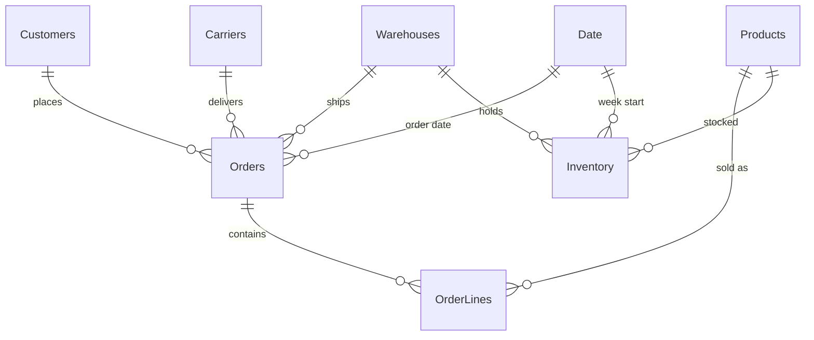

# Why are our deliveries late, and what is it costing us?

A Power BI project on delivery and stock problems at an online retailer.


## The problem

Anyone who has ordered something online knows the feeling. The site says "arrives Tuesday", Tuesday comes and goes, and by Thursday you've already decided not to order from them again.

For the shop, that one late parcel doesn't look like much. But it adds up: refunds, cancelled orders, angry reviews, vouchers handed out as an apology, and customers who quietly never come back. On top of that, if the item is out of stock in the first place, the sale never happens at all.

I wanted to build a dashboard that a real operations manager could open on Monday morning and answer three questions:

1. Where are the late deliveries coming from: which carrier, which warehouse, which time of year?
2. What do they actually cost us, including the costs nobody puts on an invoice?
3. Where are we losing sales because products are out of stock, and why does it keep happening?

## The company

UrbanCart GmbH is a made-up German online shop (electronics, home, fashion, beauty, sports, books). It ships from five warehouses (Berlin, Hamburg, Munich, Frankfurt and Leipzig) using four delivery partners, from premium to budget.

I couldn't get real order data from a company, so I wrote a Python script that generates two years of it (2024 and 2025): about 46,000 orders, 6,000 customers, 120 products and weekly stock levels. I didn't want random noise, so the data is built around problems I've read about again and again in supply chain case studies: a cheap carrier that cuts corners, a warehouse that can't handle Christmas, and stock planning based on numbers that are out of date. The dashboard's job is to find them.

The carrier names are invented too, so nothing here is a comment on a real company.

## What I found

**1. The cheapest carrier is not the cheapest.**
CargoWay charges about €4 per parcel, half of what the premium option costs. But nearly 1 in 4 of its parcels arrive late (23.7%), compared to 7–12% for the others. Once I added the refunds, cancellations and apology vouchers that come with those late parcels, CargoWay works out at about €11 per order. That's more than NordLogistik (€9.28) and roughly the same as the premium carrier.

| Carrier | Shipping cost / order | Late deliveries | True cost / order |
|---|---|---|---|
| SwiftFreight (premium) | €8.82 | 7.3% | €11.11 |
| NordLogistik | €6.04 | 9.9% | €9.28 |
| ExpressLine | €5.71 | 11.8% | €9.50 |
| CargoWay (budget) | €4.02 | 23.7% | €11.04 |

**2. Leipzig falls apart every Christmas.**
For most of the year all five warehouses deliver on time about 88% of the time. In November and December the others slip to around 83–84%, which is expected. Leipzig drops to 63%. It has roughly half the daily capacity of the other sites but still gets half of the East region's orders, and the heatmap on page 2 makes the problem very hard to miss.

**3. Late parcels lose customers, not just orders.**
Reviews go from 4.4 stars for on-time orders down to 2.3 when a parcel is 5+ days late, and returns almost triple. More importantly, customers who had a bad delivery (3+ days late or cancelled) were much less likely to order again within 90 days: 67% versus 80% for everyone else. Over the two years that's around 3,000 bad experiences, and the follow-up orders lost from them are worth roughly €70k by my estimate. That's on top of the €195k already lost to refunds, cancellations and apology vouchers.

**4. Electronics keep running out because the system has the wrong lead times.**
Overall we fill 91% of demand from stock. Electronics only manage 65%. The reason turned out to be simple: the stock planning system assumes suppliers deliver in 9 days, but electronics suppliers actually take around 31. So reorders go out far too late, every single time. Electronics account for €1.14M of the €1.54M in sales lost to stockouts.

## What I would recommend

- **Move volume away from CargoWay**, at least for the East region and for peak season. Moving all of it to NordLogistik would save about €11k a year in direct costs and avoid close to 900 late parcels a year, before counting the customers you keep.
- **Fix Leipzig's peak season** by sending more of the East region's November–December orders through Berlin, or by adding temporary staff from late October.
- **Update the supplier lead times in the planning system**, starting with electronics. This is the cheapest fix in the whole project and has the biggest money attached to it.
- **Treat "3+ days late" as a customer retention problem**, not just a logistics one, for example with a proactive message and voucher before the customer complains.

## The dashboard

Five pages, each answering one question:

| Page | Question it answers |
|---|---|
| 1. Executive Overview | How are we doing, and what is lateness costing us? |
| 2. Delivery Performance | Where do late deliveries come from? |
| 3. Cost & Carriers | Is the cheapest carrier actually cheapest? |
| 4. Customer Impact | Do late parcels hurt reviews, returns and repeat orders? |
| 5. Inventory & Stockouts | Where are we losing sales to empty shelves, and why? |

| | |
|---|---|
|  |  |
|  |  |

## How it's built

**Data model.** A standard star schema with two fact tables (orders and weekly inventory) sharing the same product, warehouse and date tables.



**Power Query** does the cleaning: fixing data types (including a decimal separator issue that bites on German Windows settings), working out how many days late each order was, and sorting orders into delay buckets.

**DAX** does the rest. There are about 45 measures, grouped into sales, delivery, cost, customer and inventory. A few I'm happy with:

- `True Cost per Order`: shipping price plus the hidden cost of that carrier's lateness
- `Reorder Rate 90d`: did the customer come back within 90 days, ignoring the last 90 days of data where we can't know yet
- `Lost Sales Revenue`: units we couldn't sell because of stock-outs, valued at each product's price

Before trusting any number in the report, I recalculated the main KPIs in Python (`scripts/validate_kpis.py`) and checked the DAX gives the same answer.

## Repo layout

```
data/                    the 7 CSV files used by the report
scripts/
  generate_data.py       creates the dataset (fixed seed, so you get the same numbers)
  validate_kpis.py       recalculates the KPIs in pandas to check the DAX
powerbi/
  UrbanCart_SupplyChain.pbix
  power-query/           M code for each table
  dax/                   date table, calculated columns, all measures
  urbancart_theme.json   report colours and fonts
docs/
  BUILD_GUIDE.md         how to rebuild the report step by step
  DATA_DICTIONARY.md     every table and column explained
images/                  dashboard screenshots
```

## Running it yourself

1. Download or clone this repo.
2. Open `powerbi/UrbanCart_SupplyChain.pbix` in Power BI Desktop (free, Windows).
3. If it can't find the data, go to **Transform data → Edit parameters** and point `DataFolder` at your local `data` folder.

To regenerate the data or check the numbers:

```bash
pip install pandas numpy
python scripts/generate_data.py
python scripts/validate_kpis.py
```

If you'd like to build the report from scratch, [docs/BUILD_GUIDE.md](docs/BUILD_GUIDE.md) walks through it.

## What I'd do next

- Connect it to a live database instead of CSV files, with scheduled refresh in the Power BI service
- Add row-level security so each warehouse manager only sees their own site
- Build a simple forecast of late-delivery risk per order using the same features

## About me

I'm Karan Lodha, an MSc Data Science, AI & Digital Business student at Gisma University of Applied Sciences in Berlin. I'm interested in using data to fix the unglamorous problems that cost businesses real money. If you have feedback on this project, I'd genuinely like to hear it.

[LinkedIn](https://www.linkedin.com/in/karanlodha/) · [GitHub](https://github.com/Karan6528)
