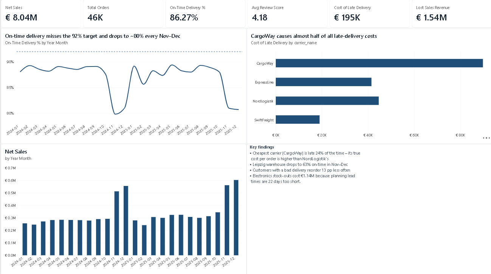
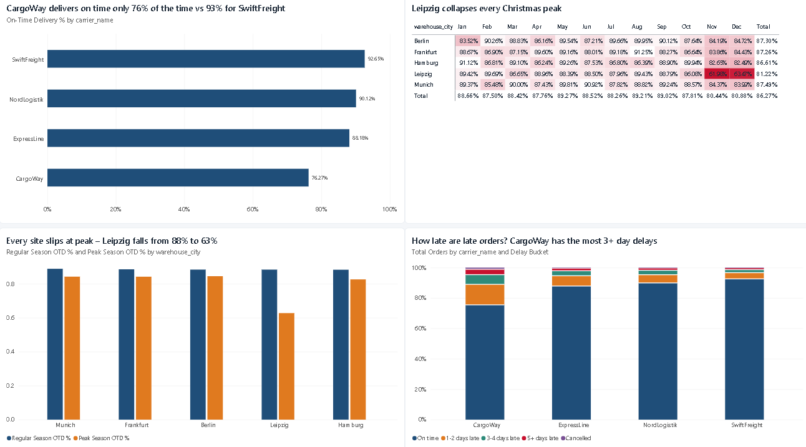
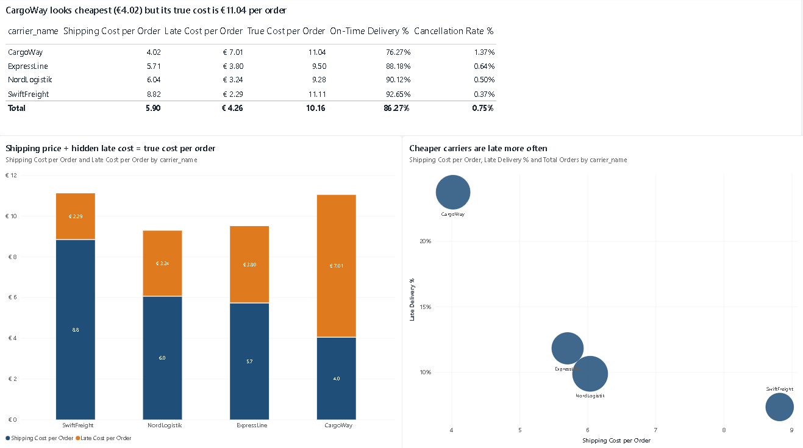
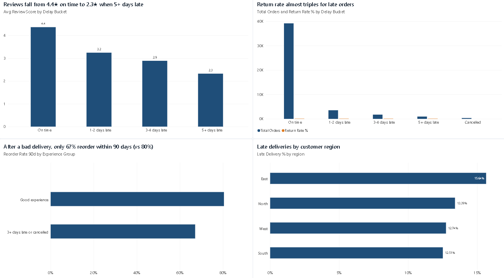
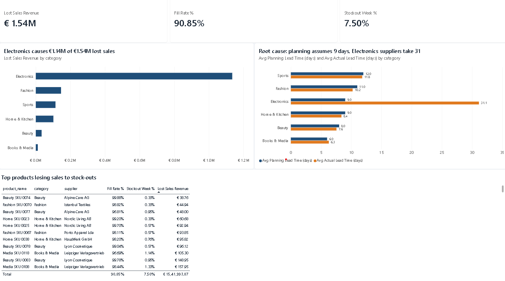

# Supply Chain Delivery Analytics (Power BI)



## Why I built this

I order a lot of stuff online, and late parcels annoy me more than they should. At some point I started wondering what a late delivery actually costs the shop. Not just the refund, but the bad review, the voucher they send to say sorry, and the fact that I probably won't order from them again.

So I picked that as my Power BI project. The idea was to build the kind of report an operations manager would actually open on a Monday morning and use to answer three questions:

- Where do the late deliveries come from? (carrier, warehouse, time of year)
- How much are they really costing us?
- Why do we keep running out of stock on some products?

## About the data

I couldn't get real order data from a company, so I made my own. The company is called UrbanCart GmbH. It's a fake online shop in Germany with 5 warehouses (Berlin, Hamburg, Munich, Frankfurt, Leipzig) and 4 delivery partners. The carrier names are made up too.

I wrote a Python script (`scripts/generate_data.py`) that creates 2 years of data: about 46k orders, 6k customers, 120 products and weekly stock levels. I didn't want completely random numbers, so I built in a few problems that come up a lot in supply chain case studies, and then used the dashboard to see if they showed up clearly. They did.

## What I found

**The cheapest carrier ends up being one of the most expensive.**
CargoWay only charges around €4 per parcel, so on paper it's the best deal. But almost 1 in 4 of its parcels arrive late. When I added the refunds, cancellations and €5 apology vouchers that come with those late parcels, the real cost came to €11.04 per order. NordLogistik charges €6 but its real cost is only €9.28.

| Carrier | Price per parcel | On time | Real cost per order |
|---|---|---|---|
| SwiftFreight | €8.82 | 92.7% | €11.11 |
| NordLogistik | €6.04 | 90.1% | €9.28 |
| ExpressLine | €5.71 | 88.2% | €9.50 |
| CargoWay | €4.02 | 76.3% | €11.04 |

**Leipzig can't handle Christmas.**
Most of the year every warehouse is around 88% on time. In November and December all of them get a bit worse, but Leipzig drops to 63%. It has about half the capacity of the other sites and still gets half of the orders from East Germany. You can see it straight away in the heatmap on the Delivery page.

**Late parcels cost customers, not just money.**
On-time orders get 4.4 stars on average. Orders that are 5+ days late get 2.3. Returns go up a lot too. The part I found most interesting: customers who had a really bad delivery (3+ days late or cancelled) were less likely to order again within 90 days, 67% compared to 80%.

**Electronics keep running out because the planning numbers are wrong.**
Overall the shop can serve about 91% of demand from stock, but electronics only manage about 65%. The reason was simple once I found it. The planning system assumes suppliers deliver in 9 days, but electronics suppliers actually take around 31. So every reorder goes out too late. Electronics make up €1.14M of the €1.54M in sales lost to empty shelves.

## What I'd suggest

1. Stop using CargoWay so much, especially in peak season. NordLogistik is cheaper once you count the late deliveries.
2. Help Leipzig in November and December, either by routing some East orders through Berlin or by adding temporary staff.
3. Fix the supplier lead times in the planning system, starting with electronics. It's probably the easiest fix here and it has the most money attached to it.

## The report

There are 5 pages:

1. **Overview**: the main KPIs, the on-time trend and the key findings
2. **Delivery**: carriers and warehouses compared, plus a heatmap by month
3. **Cost**: the real cost per carrier once lateness is included
4. **Customers**: reviews, returns and repeat orders by how late the parcel was
5. **Inventory**: lost sales by category and why they happen

| | |
|---|---|
|  |  |
|  |  |

## How I built it

- **Python** to generate the data, and a second script (`scripts/validate_kpis.py`) to recalculate the main numbers so I could check my DAX was right.
- **Power Query** to load and clean the CSVs. One thing I learned the hard way: on a German Windows setup Power BI reads "7.90" as 790, so every type change uses the en-US locale.
- **Data model**: a star schema with two fact tables (orders and weekly inventory) and shared tables for products, warehouses, carriers, customers and dates.
- **DAX**: around 45 measures. The ones I spent the most time on were `True Cost per Order`, `Reorder Rate 90d` and `Lost Sales Revenue`.

All the Power Query and DAX code is in the `powerbi/` folder if you want to look at it without opening the .pbix.

## Folder structure

```
data/         7 CSV files used by the report
scripts/      Python scripts to create the data and check the numbers
powerbi/      the .pbix file, Power Query code, DAX measures, theme
docs/         step-by-step build guide and data dictionary
images/       screenshots of the report
```

## How to open it

1. Download or clone this repo.
2. Open `powerbi/UrbanCart_SupplyChain.pbix` in Power BI Desktop (it's free).
3. If it can't find the data, go to **Transform data → Edit parameters** and change `DataFolder` to wherever you saved the `data` folder.

If you want to recreate the data yourself:

```bash
pip install pandas numpy
python scripts/generate_data.py
python scripts/validate_kpis.py
```

## Things I'd like to add

- Connect it to a real database instead of CSV files
- Row-level security so each warehouse manager only sees their own site
- A simple model that predicts which orders are likely to be late

## About me

I'm Karan, doing my MSc in Data Science, AI & Digital Business at Gisma in Berlin. If you have any feedback on this project, I'd really like to hear it.

[LinkedIn](https://www.linkedin.com/in/karanlodha/) · [GitHub](https://github.com/Karan6528)
